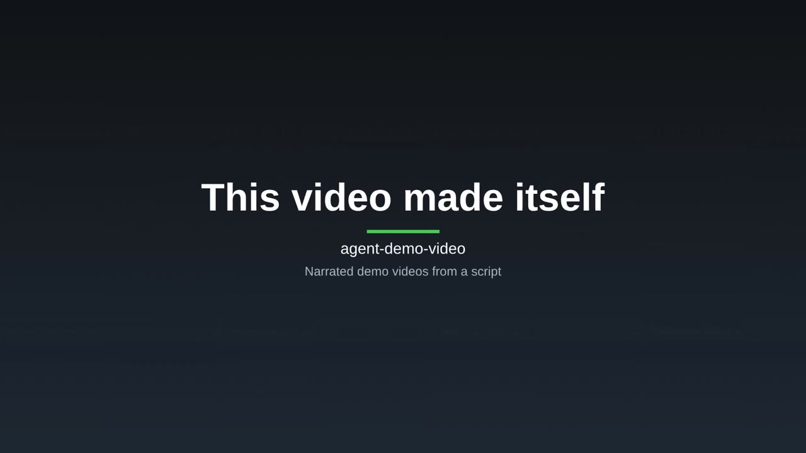

# agent-demo-video

Turn a `DEMO_SCRIPT.md` and a running web app into a finished, narrated, captioned MP4, headless and
repeatable. Narration is generated first and becomes the clock for the screen recording and the
captions, so audio, video and captions stay in sync by construction. Length is capped by
`maxDurationSec` (default 300).

[](https://github.com/OrionArchitekton/agent-demo-video/releases/download/v0.3.0/agent-demo-video-self-demo.mp4)

Watch the self-demo (one minute): the tool rendered it of a sample app and of its own script, run
and checks, from [`demos/self/`](demos/self/README.md).

## Install

All three ways need Node 18 or newer and ffmpeg 5.1 or newer plus ffprobe on `PATH`
(`apt install ffmpeg` or `brew install ffmpeg`; check with `ffmpeg -version`).

**Claude Code plugin.** Adds a `demo-video` skill that walks Claude through a video, and a
read-only `render-reviewer` agent that checks the contact sheet before narration is spent:

```text
/plugin marketplace add OrionArchitekton/agent-demo-video
/plugin install agent-demo-video@agent-demo-video
```

Then ask Claude for a demo video of your app. The skill runs the CLI through `npx`.

**npx or a global install:**

```bash
npx -y -p agent-demo-video@0.3.0 playwright install chromium   # one time: the browser build this CLI uses
npx -y agent-demo-video@0.3.0 demo.config.json
# or: npm install -g agent-demo-video, then: demo-video demo.config.json
```

**From source:**

```bash
git clone https://github.com/OrionArchitekton/agent-demo-video.git
cd agent-demo-video
pnpm install
pnpm exec playwright install chromium
```

## Quickstart

From a source checkout, render the bundled smoke demo with silent narration. It needs no API key
and no running app:

```bash
FAKE_TTS=1 pnpm demo demos/smoke/demo.config.json
```

Output lands in `demos/smoke/out/`: `final.mp4`, `captions.srt`, `contact-sheet.png` and
`render-report.json`.

For your own app:

1. Write a `DEMO_SCRIPT.md`: one `### SHOT <id>` per shot, with narration and browser actions
   ([script format](docs/guide/script-format.md)).
2. Write a `demo.config.json` that points at the script and your running app
   ([config](docs/guide/config.md); sample: [`demo.config.sample.json`](demo.config.sample.json)).
3. Render with `FAKE_TTS=1` first and look at `contact-sheet.png`.
4. Choose a voice and render for real.

```markdown
### SHOT intro
- target: dashboard
- narration: This is the dashboard. Every active workflow, at a glance.
- action: goto url="/"
- action: highlight selector="#workflows"
- action: wait ms=800
```

## Voice

- **ElevenLabs.** Set `ELEVENLABS_API_KEY`. Without a key the run stops rather than shipping a
  silent video.
- **Your own text-to-speech.** `voice.provider: "command"` runs any program you can call from a
  shell, with an optional aligner for word-timed captions ([voice](docs/guide/voice.md)).
- **Silent.** `FAKE_TTS=1` renders placeholder narration of estimated length, for drafts.

## Features

- **Screencast capture** with an animated cursor, highlights, chapter cards, zoom on action, a
  slowly drifting camera, a framed scene and light sound design
  ([how the pipeline works](docs/guide/pipeline.md)).
- **Fail-closed preflight.** Selectors are checked against the running app before any narration is
  generated. Shots behind a login, and selectors that follow a click or type in the same shot, are
  reported rather than proven ([preflight](docs/guide/preflight.md)).
- **Apps behind a login.** `target: live` drives a saved browser profile kept outside the repo;
  `demo-video login <config.json>` creates it ([authenticated capture](docs/guide/authenticated-capture.md)).
- **Prebaked clips and third-party tabs** for surfaces you cannot or prefer not to automate
  ([third-party tabs](docs/guide/third-party-tabs.md)).
- **Shorts.** `"platform": "shorts"` renders 9:16, and `brand.hook` puts large text on the first
  frame ([config](docs/guide/config.md)).
- **Quality checks.** When `voice.aligner` is configured, a transcript check compares what the
  video says with the script, and Shorts without a hook are flagged ([quality checks](docs/guide/quality-checks.md)).
- **Motion cards.** `brand.motion: true` animates the title and end cards with HyperFrames, an
  optional add-on ([motion cards](docs/guide/motion-cards.md)).
- **Verified output.** Every render probes the delivered `final.mp4` against the configured
  format, writes a `contact-sheet.png` with one still per segment (title and end cards included), and records everything in
  `render-report.json`.

## CLI

```text
demo-video <config.json> [--no-preflight] [--out <new-directory>] [--script <absolute-file>]
                         [--clips-dir <absolute-directory>] [--render-host <host>]
demo-video login <config.json>
```

## Documentation

- [How the pipeline works](docs/guide/pipeline.md)
- [Script format](docs/guide/script-format.md)
- [Config](docs/guide/config.md)
- [Preflight selector gate](docs/guide/preflight.md)
- [Authenticated capture](docs/guide/authenticated-capture.md)
- [Third-party tabs](docs/guide/third-party-tabs.md)
- [Voice](docs/guide/voice.md)
- [Quality checks](docs/guide/quality-checks.md)
- [Motion cards](docs/guide/motion-cards.md)
- [Changelog](CHANGELOG.md)

## Replicability

Pin `voice.seed` in your config and lock your ffmpeg and Chromium versions to get byte-stable
reruns from the same script. The only inputs that change between demo iterations are
`DEMO_SCRIPT.md` and `demo.config.json`; everything else is deterministic given the same narration
audio.

## License

MIT
